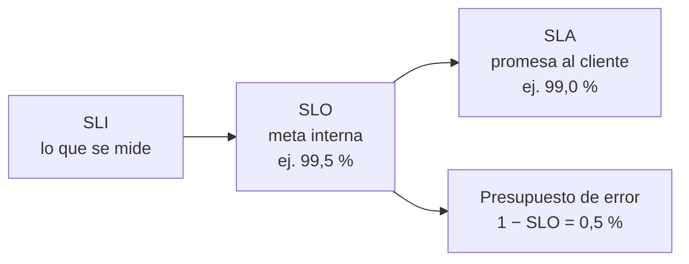
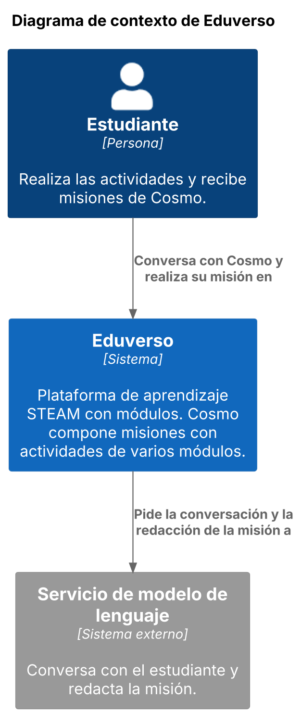
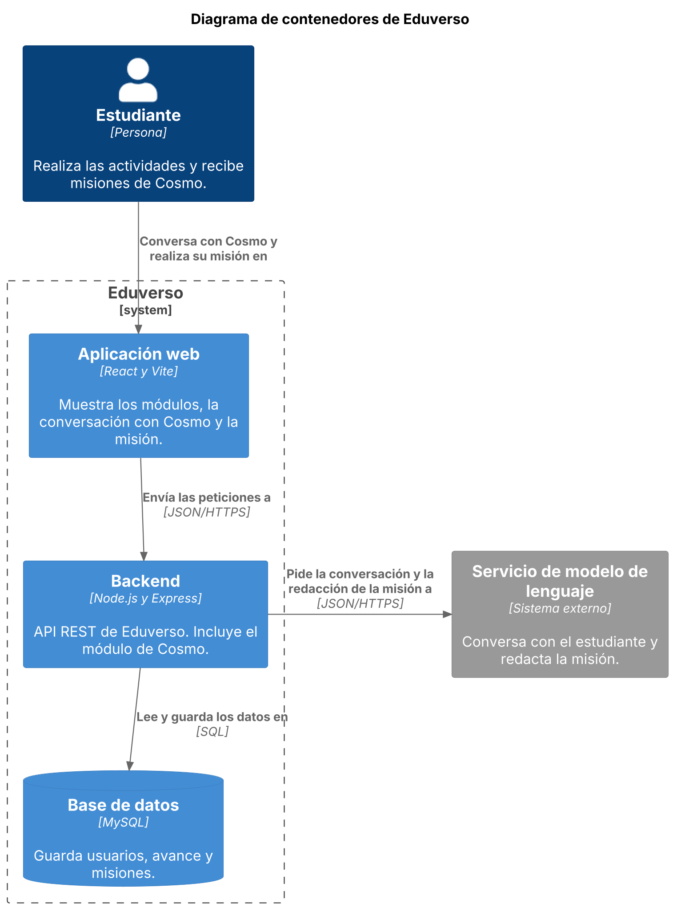
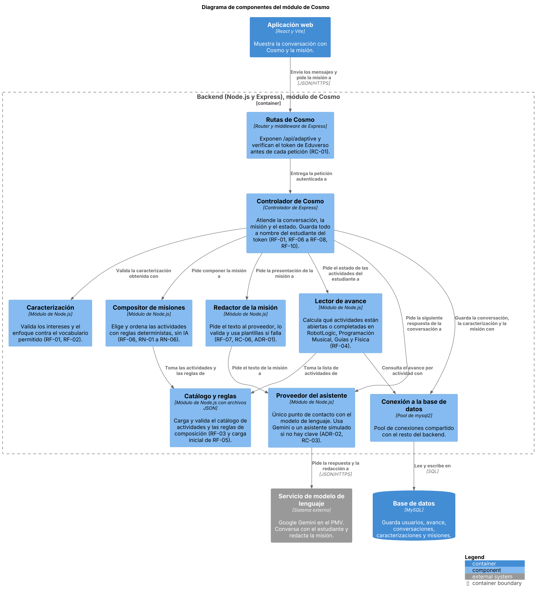

# Niveles de servicio de Eduverso y del módulo de Cosmo

**Trabajo final.** SLA, SLO, SLI y presupuesto de error de un software propio que se lleva a producción.
**Autor.** Julián David Fuentes Granja, Ingeniería de Sistemas, Universidad de San Buenaventura Cali.
**Software.** Eduverso con el módulo de Cosmo, el producto mínimo viable (PMV) de mi proyecto de grado.
**Fecha.** Noviembre de 2026.

## Contenido

1. [Contexto del software](#1-contexto-del-software)
2. [Definiciones](#2-definiciones)
3. [Arquitectura que se lleva a producción](#3-arquitectura-que-se-lleva-a-producción)
4. [Supuestos de producción](#4-supuestos-de-producción)
5. [Características de calidad que definen los niveles](#5-características-de-calidad-que-definen-los-niveles)
6. [Indicadores de nivel de servicio (SLI)](#6-indicadores-de-nivel-de-servicio-sli)
7. [Objetivos de nivel de servicio (SLO)](#7-objetivos-de-nivel-de-servicio-slo)
8. [Presupuesto de error](#8-presupuesto-de-error)
9. [Acuerdo de nivel de servicio (SLA)](#9-acuerdo-de-nivel-de-servicio-sla)
10. [Cómo se mediría](#10-cómo-se-mediría)
11. [Ejemplo con un mes simulado](#11-ejemplo-con-un-mes-simulado)
12. [Riesgos encontrados al revisar el PMV](#12-riesgos-encontrados-al-revisar-el-pmv)
13. [Conclusiones](#13-conclusiones)
14. [Referencias](#14-referencias)
- [Anexo A. Diagramas C4](#anexo-a-diagramas-c4)

---

## 1. Contexto del software

Eduverso es una plataforma web de aprendizaje STEAM para estudiantes de colegio. Agrupa varios módulos con actividades por niveles. Están RobotLogic, que enseña lógica de programación con robots, Programación Musical, el Laboratorio de Física y las guías de proyectos. Cada módulo guarda el avance del estudiante y desbloquea el siguiente nivel cuando completa el anterior.

El problema que aborda mi proyecto de grado es que cada módulo funciona por separado. El estudiante no tiene un camino que conecte lo que hace en un módulo con lo que puede hacer en otro, ni una propuesta que tenga en cuenta lo que le interesa. Por eso el proyecto le da a Cosmo, la mascota de Eduverso, la función de asistente. Cosmo conversa con el estudiante para conocer sus intereses y su forma de abordar los retos. Luego le compone una **misión**, que es un conjunto ordenado de actividades de varios módulos con la razón por la que cada una hace parte de ella.

La composición de la misión la hacen reglas deterministas que respetan el avance y los prerrequisitos. Un modelo de lenguaje (Google Gemini en el PMV) solo conversa con el estudiante y redacta el texto de la misión. Si la IA falla, la misión se entrega igual con textos de plantilla.

Este trabajo supone que el PMV sale a un ambiente productivo y define para él las cuatro piezas de la gestión de niveles de servicio. Es un trabajo incremental sobre la arquitectura que ya se diagramó con el modelo C4 en los ejercicios anteriores, así que cada indicador dice en qué elemento del C4 se mide. Los diagramas están en el [Anexo A](#anexo-a-diagramas-c4).

El trabajo cubre dos servicios que el estudiante percibe por separado.

- **La plataforma Eduverso**, que da acceso a los módulos.
- **El módulo de Cosmo**, que conversa con el estudiante y le entrega la misión.

## 2. Definiciones

Las definiciones siguen el libro de Ingeniería de Confiabilidad de Sitios (SRE) de Google [1] y su libro de trabajo [2].

| Término | Qué es | Quién lo define y para quién | Ejemplo en este trabajo |
|---|---|---|---|
| **SLI** (indicador de nivel de servicio) | Una medida cuantitativa y definida con cuidado de algún aspecto del servicio que recibe el usuario. Se expresa como la proporción de eventos buenos sobre eventos válidos, así que va de 0 % a 100 %. | El equipo técnico, para medir. | Proporción de peticiones de la misión respondidas en menos de 2 segundos. |
| **SLO** (objetivo de nivel de servicio) | El valor objetivo que debe alcanzar un SLI durante una ventana de tiempo. Tiene la forma *SLI ≥ meta*. Es un compromiso interno y no tiene sanciones económicas. | El equipo, para sí mismo. | El 95 % de las misiones se entrega en menos de 2 segundos en 28 días. |
| **SLA** (acuerdo de nivel de servicio) | El contrato con el cliente que fija qué niveles se le prometen y qué pasa si no se cumplen, por ejemplo una compensación. Sus metas son más bajas que las del SLO para dejar un margen de seguridad. | El proveedor y el cliente, por escrito. | El colegio recibe días de licencia gratis si la disponibilidad mensual baja de 99 %. |
| **Presupuesto de error** (*error budget*) | La cantidad de fallas que se tolera en la ventana sin incumplir el SLO. Es *1 − SLO*. Mientras quede presupuesto se pueden lanzar cambios, y cuando se agota se prioriza la confiabilidad. | El equipo, como regla de decisión. | Con un SLO de 99,5 % y 400.000 peticiones, se toleran 2.000 fallas en 28 días. |

La relación entre los cuatro es jerárquica. El SLI mide, el SLO fija la meta interna sobre esa medida, el presupuesto de error dice cuánto se puede fallar antes de incumplir el SLO y el SLA es la promesa externa, más holgada que el SLO. Si el equipo cuida el SLO, el SLA se cumple con margen.



Una idea central del enfoque es que ningún SLO debe ser 100 %. Llegar a ese valor sale muy caro, frena los cambios y el usuario no lo nota, porque su conexión a internet o su dispositivo fallan más que eso [1].

## 3. Arquitectura que se lleva a producción

**Contexto (nivel 1).** Eduverso es un solo sistema que usa el estudiante. Su único sistema externo es el servicio de modelo de lenguaje.

**Contenedores (nivel 2).** Una aplicación web en React y Vite, un backend en Node.js y Express que incluye el módulo de Cosmo y una base de datos MySQL.

**Componentes del módulo de Cosmo (nivel 3).** Lo que más pesa en la confiabilidad es cómo se reparte el trabajo dentro del módulo.

| Componente | Por qué importa para los niveles de servicio |
|---|---|
| Rutas de Cosmo | Son la puerta de entrada `/api/adaptive`. Ahí se miden todas las peticiones de Cosmo. |
| Controlador de Cosmo | Atiende la conversación y la misión. Sus tiempos de respuesta son los que ve el estudiante. |
| Compositor de misiones | Elige las actividades con reglas deterministas y sin IA, así que no depende de terceros. |
| Redactor de la misión | Pide el texto a la IA y, si falla o el texto no sirve, usa plantillas. El estudiante nunca ve el error. |
| Proveedor del asistente | Es el único que habla con Gemini. Espera hasta 15 s por respuesta y reintenta una vez. |
| Lector de avance | Toma las actividades del catálogo y lee el avance de RobotLogic, Programación Musical, Guías y Física. Si la base de datos falla, no hay misión. |
| Conexión a la base de datos | Un único grupo de 10 conexiones compartido por toda la plataforma. |

De esta arquitectura salen dos hechos que guían todo el documento. El primero es que la misión se puede entregar aunque la IA falle, porque las actividades las eligen reglas y el texto tiene plantillas de respaldo. Por eso la falla de Gemini no se cuenta como caída de Cosmo, sino como degradación, y tiene su propio indicador. El segundo es que Cosmo corre dentro del mismo proceso del backend. Un error grave de Cosmo puede tumbar toda la plataforma, y por eso la disponibilidad de la plataforma se mide sobre todas las rutas, incluidas las de Cosmo.

## 4. Supuestos de producción

Ninguna de estas cifras viene de una operación real. Son supuestos razonables para un primer lanzamiento y se deben revisar después del primer trimestre con los datos medidos.

| # | Supuesto | Valor |
|---|---|---|
| S-01 | Clientes | 20 colegios de Cali que compran licencias anuales de Eduverso. |
| S-02 | Usuarios | Unos 4.000 estudiantes con cuenta. Hasta 5 grupos de 30 estudiantes conectados al mismo tiempo (150 usuarios concurrentes), según la cifra de 30 por aula del requisito RC-04. |
| S-03 | Horario de servicio | Lunes a viernes de 6:00 a 18:00, hora de Colombia, que cubre las jornadas de mañana y tarde. Fuera de ese horario el servicio sigue en línea, pero sin compromiso. |
| S-04 | Tiempo de servicio | 12 horas por 20 días hábiles en una ventana de 28 días, es decir 240 horas o 14.400 minutos. En un mes calendario de 22 días hábiles son 15.840 minutos. |
| S-05 | Volumen en 28 días | 400.000 peticiones a la API, 30.000 peticiones de misión, 40.000 mensajes a Cosmo y 4.000 misiones compuestas. |
| S-06 | Infraestructura | Aplicación web y backend en Google Cloud Run y base de datos en Cloud SQL para MySQL, edición Enterprise. |
| S-07 | Proveedor de IA | API de Gemini con el modelo `gemini-3.1-flash-lite`, que es el que usa el PMV. |
| S-08 | Equipo | Un equipo pequeño de desarrollo que también opera la plataforma, con soporte en horario hábil. |

**Techo que impone la infraestructura.** Google ofrece para Cloud Run un SLA de 99,95 % de disponibilidad mensual en la mayoría de regiones [3] y para Cloud SQL Enterprise un SLA de 99,95 % sin contar el mantenimiento [4]. Como la plataforma necesita los dos, su disponibilidad máxima teórica es 0,9995 × 0,9995 ≈ 99,90 %. Ningún SLO de disponibilidad de este documento puede pasar de esa cifra, y los que se proponen quedan por debajo para absorber los errores propios del código y de los despliegues.

**El proveedor de IA no ofrece garantía.** La API de Gemini que se usa desde Google AI Studio no incluye un SLA, ni en el nivel gratuito ni en el pagado, y para tener uno hay que pasar a Vertex AI [5]. Por eso este documento no promete al cliente nada que dependa de la IA y deja ese aspecto como un SLO interno.

## 5. Características de calidad que definen los niveles

El proyecto de grado ya prioriza siete atributos de calidad (RC-01 a RC-07) con sus escenarios de prueba (ESC-01 a ESC-07). No todos se convierten en SLO. Un SLO sirve para lo que se puede medir de forma continua mientras el sistema opera y lo que el usuario nota. Lo demás se verifica con pruebas antes de cada lanzamiento.

| Atributo | Requisito del proyecto | ¿Se vuelve SLO? | Decisión |
|---|---|---|---|
| **Fiabilidad y disponibilidad** (RC-02, RC-06) | La plataforma sigue funcionando si Cosmo falla. Si la IA no responde, el estudiante no ve un error. | Sí | SLI-01 (plataforma), SLI-02 (Cosmo) y SLI-05 (misión redactada por la IA). |
| **Eficiencia de desempeño** (RC-04) | La misión se entrega en menos de 2 s con 30 estudiantes a la vez, en el 95 % de las peticiones (ESC-04). | Sí | SLI-03 (misión) y SLI-04 (respuesta de la conversación). |
| **Adecuación funcional** (RC-07) | Ninguna misión incluye actividades que el estudiante no pueda abrir. | Sí | SLI-06. Es un SLO de corrección y casi no tiene margen. |
| **Seguridad** (RC-01) | Cada estudiante solo ve lo suyo y la IA no recibe datos que lo identifiquen. | No | Es una condición que se cumple o no. Se verifica con las pruebas de ESC-01 y una falla es un incidente de seguridad, no un consumo de presupuesto. |
| **Mantenibilidad** (RC-03) | Las reglas y el mecanismo de la IA se cambian sin tocar el resto. | No | Es una propiedad del código y el usuario no la percibe en operación. |
| **Capacidad de interacción** (RC-05) | Las pantallas cumplen WCAG 2.1 AA. | No | Se revisa en cada versión con la prueba de ESC-05. |
| **Durabilidad de los datos** | El avance del estudiante no se pierde. | En el SLA | Se compromete como punto de recuperación y tiempo de recuperación (sección 9.5). |

## 6. Indicadores de nivel de servicio (SLI)

Todos los SLI se expresan como eventos buenos sobre eventos válidos y solo cuentan dentro del horario de servicio (S-03). Un evento válido es una petición que el servicio debía atender. Las respuestas 4xx (token vencido, datos mal enviados, ruta inexistente) no cuentan porque son errores del cliente. La excepción es la 429, que sí es una falla del servicio.

| SLI | Nombre | Evento válido | Evento bueno | Dónde se mide (elemento del C4) |
|---|---|---|---|---|
| **SLI-01** | Disponibilidad de la plataforma | Toda petición válida a `/api/*` | La respuesta no es 5xx ni 429 | Contenedor *Backend* (nivel 2) |
| **SLI-02** | Disponibilidad de Cosmo | Toda petición válida a `/api/adaptive/*` | La respuesta no es 5xx ni 429 | Componente *Rutas de Cosmo* (nivel 3) |
| **SLI-03** | Latencia de la misión | Peticiones válidas para ver o pedir una misión | Respuesta correcta en menos de 2.000 ms | Componente *Controlador de Cosmo* (nivel 3) |
| **SLI-04** | Latencia de la conversación | Mensajes válidos del estudiante a Cosmo | Respuesta correcta en menos de 5.000 ms | Componente *Proveedor del asistente* (nivel 3) |
| **SLI-05** | Misión redactada por la IA | Toda misión compuesta | La misión quedó con el texto de la IA validado y no con la plantilla | Componente *Redactor de la misión* (nivel 3) |
| **SLI-06** | Misiones correctas | Toda misión compuesta | Ninguna de sus actividades estaba bloqueada para el estudiante y se respetaron los prerrequisitos (RN-01, RN-02) | Componente *Compositor de misiones* (nivel 3) |

**Por qué se separan SLI-02 y SLI-05.** Si Gemini se cae, Cosmo sigue entregando misiones con las plantillas. Desde el punto de vista del estudiante el servicio funciona, así que no es una caída (SLI-02). Pero la experiencia es más pobre, y eso es lo que mide SLI-05. Mezclarlos haría que cada caída de un tercero que el equipo no controla gastara el presupuesto de disponibilidad.

**Por qué la conversación tiene un umbral más alto que la misión.** Cada mensaje a Cosmo espera la respuesta de Gemini, que tarda en promedio entre 1 y 3 segundos. La misión, en cambio, se compone con reglas locales y solo el texto depende de la IA. El umbral de 2 s viene del requisito RC-04 y el de 5 s es un supuesto de lo que tolera un estudiante en un chat.

## 7. Objetivos de nivel de servicio (SLO)

La ventana de todos los SLO es de **28 días rodantes**, que siempre incluye la misma cantidad de lunes y viernes y evita que los meses largos se vean mejor que los cortos [2].

| SLO | Indicador | Meta | Justificación |
|---|---|---|---|
| **SLO-01** | SLI-01, disponibilidad de la plataforma | **99,5 %** | Queda por debajo del techo de 99,90 % de la infraestructura con margen para despliegues y errores propios. En una clase de 45 minutos el estudiante casi nunca encontraría una caída. |
| **SLO-02** | SLI-02, disponibilidad de Cosmo | **99,0 %** | Cosmo es nuevo y menos crítico que la plataforma. Si falla, el estudiante sigue usando todos los módulos (RC-02). |
| **SLO-03** | SLI-03, latencia de la misión | **95 % en menos de 2 s** | Es el requisito RC-04 tal como lo mide ESC-04. |
| **SLO-04** | SLI-04, latencia de la conversación | **95 % en menos de 5 s** | Supuesto de tolerancia en un chat, con la latencia típica de un modelo ligero. |
| **SLO-05** | SLI-05, misión redactada por la IA | **90 %** | Meta baja a propósito porque depende de un tercero sin SLA y el respaldo con plantillas ya protege al estudiante (RC-06). |
| **SLO-06** | SLI-06, misiones correctas | **99,9 %** | Las reglas son deterministas, así que una falla indica un defecto. No se pone 100 % porque el avance de los módulos puede cambiar entre la lectura y la entrega. |

## 8. Presupuesto de error

### 8.1 Cuánto se puede fallar

El presupuesto es *1 − SLO* aplicado al tiempo o a los eventos de la ventana (S-04 y S-05).

| SLO | Meta | Presupuesto | En tiempo (14.400 min de servicio) | En eventos (volumen S-05) |
|---|---|---|---|---|
| SLO-01 plataforma | 99,5 % | 0,5 % | **72 minutos** sin servicio | 2.000 de 400.000 peticiones fallidas |
| SLO-02 Cosmo | 99,0 % | 1,0 % | **144 minutos** | 700 de 70.000 peticiones a Cosmo |
| SLO-03 misión < 2 s | 95 % | 5 % | No aplica | 1.500 de 30.000 misiones lentas |
| SLO-04 conversación < 5 s | 95 % | 5 % | No aplica | 2.000 de 40.000 mensajes lentos |
| SLO-05 redacción con IA | 90 % | 10 % | No aplica | 400 de 4.000 misiones con plantilla |
| SLO-06 misiones correctas | 99,9 % | 0,1 % | No aplica | 4 de 4.000 misiones incorrectas |

### 8.2 Política de uso del presupuesto

El presupuesto existe para decidir entre lanzar cosas nuevas y estabilizar. Esta política la acuerdan el equipo de desarrollo y quien responde por la operación.

| Presupuesto consumido en la ventana | Estado | Qué se hace |
|---|---|---|
| Menos del 50 % | Normal | Se despliega con el proceso habitual (pruebas automáticas y despliegue fuera del horario de clase). |
| Entre 50 % y 75 % | Alerta | Cada despliegue lleva una revisión adicional y un plan para volver a la versión anterior. Se revisan las fallas de la semana. |
| Entre 75 % y 100 % | Crítico | Solo se despliegan correcciones y mejoras de confiabilidad. Las funciones nuevas esperan. |
| 100 % o más | Agotado | Se congelan los cambios del servicio afectado hasta que la ventana vuelva a tener margen. Se hace un análisis posterior al incidente sin culpables y se registran las acciones. |

Reglas adicionales.

1. Cualquier incidente que consuma por sí solo más del 20 % de un presupuesto exige un análisis posterior escrito, aunque no se haya agotado.
2. Si el presupuesto de SLO-05 se agota porque Gemini falla, no se congela Cosmo. Se evalúa pasar a un proveedor con SLA, como Vertex AI, o subir el plan, porque el problema no está en el código propio.
3. Una sola falla de SLO-06 se trata como defecto prioritario, aunque el presupuesto lo permita, porque una misión con una actividad bloqueada contradice la regla RN-01.
4. Si un SLO se cumple de sobra durante tres ventanas seguidas, se puede subir la meta o aprovechar el margen para lanzar más rápido.

### 8.3 Alertas por velocidad de consumo

Para no esperar al final de la ventana se vigila qué tan rápido se gasta el presupuesto, siguiendo el método del libro de trabajo de SRE [2]. Con 240 horas de servicio en la ventana se usan dos alertas.

| Alerta | Condición | Equivale a | Respuesta |
|---|---|---|---|
| Consumo rápido | Se gasta el 5 % del presupuesto en 1 hora de servicio | Consumir 12 veces más rápido de lo permitido | Aviso inmediato a la persona de turno |
| Consumo lento | Se gasta el 20 % del presupuesto en 1 día de servicio | Consumir 4 veces más rápido de lo permitido | Revisión al día siguiente |

## 9. Acuerdo de nivel de servicio (SLA)

Este es el texto que se firmaría con cada colegio. Sus metas son más bajas que las de los SLO para que el equipo se entere y corrija antes de deber una compensación.

### 9.1 Partes y servicio cubierto

El acuerdo se celebra entre el equipo que opera Eduverso (el proveedor) y el colegio que compra las licencias (el cliente). Cubre el acceso por navegador a la plataforma Eduverso y a sus módulos, y la entrega de misiones de Cosmo a los estudiantes con licencia activa.

### 9.2 Compromisos de servicio

Los compromisos se miden por mes calendario y dentro del horario de servicio (lunes a viernes de 6:00 a 18:00, hora de Colombia).

| Compromiso | Nivel prometido | SLO interno que lo respalda | Margen |
|---|---|---|---|
| **Disponibilidad de la plataforma.** Los estudiantes pueden iniciar sesión y usar los módulos. | **99,0 %** mensual (máximo unas 2 h 38 min sin servicio en un mes de 22 días hábiles) | SLO-01, 99,5 % | 0,5 puntos |
| **Entrega de la misión de Cosmo.** El estudiante recibe una misión, redactada por la IA o con las plantillas de respaldo. | **98,0 %** mensual | SLO-02, 99,0 % | 1 punto |
| **Tiempo de entrega de la misión.** | **90 %** de las misiones en menos de 2 s | SLO-03, 95 % | 5 puntos |

El SLA no promete que el texto de la misión lo redacte la IA ni el tiempo de respuesta de la conversación, porque dependen de un proveedor que no da garantías (sección 4). Esos aspectos solo tienen SLO internos.

### 9.3 Exclusiones

No cuentan como tiempo sin servicio.

1. El mantenimiento programado fuera del horario de servicio y avisado al colegio con 72 horas de anticipación.
2. Las fallas de internet, de la red o de los equipos del colegio.
3. Las fallas del proveedor de IA mientras Cosmo siga entregando misiones con las plantillas.
4. El uso que viole los términos del servicio, como pruebas de carga sin aviso.
5. Los casos de fuerza mayor y las caídas generales de Google Cloud que superen su propio SLA.

### 9.4 Compensaciones

Si la disponibilidad de la plataforma en un mes queda por debajo de lo prometido, el colegio recibe días adicionales de licencia para todos sus estudiantes, siempre que lo solicite dentro de los 30 días siguientes.

| Disponibilidad mensual de la plataforma | Compensación |
|---|---|
| De 98,0 % a menos de 99,0 % | 3 días de licencia |
| De 95,0 % a menos de 98,0 % | 7 días de licencia |
| Menos de 95,0 % | 15 días de licencia |

Si la entrega de misiones de Cosmo queda por debajo de 98,0 %, el colegio recibe 2 días de licencia, sin sumarse a la compensación anterior en el mismo mes.

### 9.5 Datos y soporte

| Aspecto | Compromiso |
|---|---|
| Copia de seguridad | Diaria y automática, con 7 días de retención. |
| Punto de recuperación (RPO) | Como máximo se pierden 24 horas de avance ante un desastre. |
| Tiempo de recuperación (RTO) | El servicio se restaura en máximo 4 horas hábiles. |
| Incidente crítico (la plataforma no carga para el colegio) | Primera respuesta en 1 hora hábil. |
| Incidente mayor (falla un módulo o Cosmo) | Primera respuesta en 4 horas hábiles. |
| Consulta o falla menor | Primera respuesta en 2 días hábiles. |
| Canal | Correo de soporte y formulario de contacto de Eduverso. |

### 9.6 Reporte y revisión

El proveedor envía al colegio un reporte mensual con la disponibilidad medida, los incidentes y las compensaciones. El acuerdo se revisa cada semestre con los datos reales de uso.

## 10. Cómo se mediría

En producción se necesitan tres fuentes de datos. Ninguna cambia la lógica de los módulos.

| Fuente | Qué registra | SLI que alimenta |
|---|---|---|
| Registro de peticiones en el backend | Una línea por petición con la ruta declarada, el código de respuesta y el tiempo en milisegundos. No guarda el usuario, el token ni el contenido, para cumplir RC-01. | SLI-01 a SLI-04 |
| Sonda de salud | Una ruta `/api/health` que responde si el proceso y la base de datos están bien. Un servicio externo la consulta cada minuto. | SLI-01 |
| Tablas que el PMV ya tiene | La tabla `learning_missions` ya guarda si el texto de cada misión vino de la IA o de la plantilla, en la columna `narrative_source`. | SLI-05 y SLI-06 |

Una línea del registro se vería así.

```json
{"tipo":"sli","ts":"2026-11-10T13:05:12.381Z","metodo":"GET","ruta":"/api/adaptive/mission","estado":200,"ms":412}
```

Con esas líneas, cada SLI es un conteo. Por ejemplo, SLI-03 es el número de líneas de la ruta de la misión con `estado` menor que 500 y `ms` menor que 2.000, dividido entre todas las líneas válidas de esa ruta.

SLI-05 sale de una consulta sobre la base de datos del PMV.

```sql
SELECT COUNT(*) AS misiones,
       SUM(narrative_source = 'ai') AS redactadas_por_ia,
       ROUND(100 * SUM(narrative_source = 'ai') / COUNT(*), 2) AS sli_05
FROM learning_missions
WHERE created_at >= UTC_TIMESTAMP() - INTERVAL 28 DAY;
```

SLI-06 se mide con una revisión diaria que vuelve a componer las misiones del día con el avance guardado y comprueba las reglas RN-01 y RN-02. Es la misma lógica de la prueba del escenario ESC-07 del proyecto de grado.

En Google Cloud, las líneas del registro llegan a Cloud Logging, donde se convierten en métricas y en las alertas de la sección 8.3.

## 11. Ejemplo con un mes simulado

Para mostrar cómo funcionan las cuatro piezas juntas se simula una ventana de 28 días con el volumen de S-05 y tres incidentes.

| # | Incidente | Efecto |
|---|---|---|
| I-1 | Un martes a las 10:00 se cae la base de datos y se recupera en 40 minutos. | Fallan todas las peticiones a la plataforma y a Cosmo durante 40 minutos. |
| I-2 | Un despliegue de Cosmo trae un error y se revierte a los 25 minutos. | Fallan solo las peticiones a `/api/adaptive` durante 25 minutos. |
| I-3 | Gemini responde lento durante dos días seguidos. | Las misiones y los mensajes tardan más, y muchas misiones salen con plantilla. |

Con 400.000 peticiones en 14.400 minutos llegan unas 28 peticiones por minuto a la plataforma, y con 70.000 llegan unas 5 por minuto a Cosmo. A eso se suman fallas sueltas del día a día.

| SLO | Fallas del mes | SLI medido | Meta | Presupuesto usado | Estado |
|---|---|---|---|---|---|
| SLO-01 plataforma | 1.111 por I-1, 122 por I-2 y 150 sueltas, 1.383 en total | 99,65 % | 99,5 % | 69 % | Alerta |
| SLO-02 Cosmo | 194 por I-1, 122 por I-2 y 30 sueltas, 346 en total | 99,51 % | 99,0 % | 49 % | Normal |
| SLO-03 misión < 2 s | 1.800 lentas por I-3 y 300 sueltas, 2.100 en total | 93,0 % | 95 % | 140 % | **Agotado** |
| SLO-04 conversación < 5 s | 2.000 lentos por I-3 y 600 sueltos, 2.600 en total | 93,5 % | 95 % | 130 % | **Agotado** |
| SLO-05 redacción con IA | 280 con plantilla por I-3 y 100 sueltas, 380 en total | 90,5 % | 90 % | 95 % | Crítico |
| SLO-06 misiones correctas | 0 | 100 % | 99,9 % | 0 % | Normal |

**Qué decide el equipo con la política de la sección 8.2.**

- SLO-03 y SLO-04 están agotados. Se congelan las funciones nuevas de Cosmo y se prioriza bajar el tiempo de espera a Gemini, que es el riesgo 1 de la sección 12.
- SLO-01 está en alerta. Los próximos despliegues llevan revisión adicional y plan de reversión.
- I-1 consumió por sí solo el 56 % del presupuesto de SLO-01 y el 28 % del de SLO-02. Pasa del 20 %, así que exige un análisis posterior escrito.
- I-2 consumió el 17 % del presupuesto de SLO-02 y el 6 % del de SLO-01. No llega al 20 %, así que basta con registrarlo.
- SLO-05 quedó en estado crítico por culpa de un tercero. Según la regla 2 no se congela Cosmo, pero se abre la evaluación de pasar a Vertex AI.

**Qué pasa con el SLA.** El mes calendario tiene 15.840 minutos de servicio. La plataforma estuvo caída 40 minutos, así que su disponibilidad fue de 99,75 % y supera el 99,0 % prometido. La entrega de misiones falló 65 minutos, con 99,59 % contra el 98,0 % prometido. El tiempo de entrega fue de 93 % contra el 90 % prometido. **No se debe ninguna compensación.**

El ejemplo muestra para qué sirve que el SLA sea más holgado que el SLO. El equipo incumplió dos metas internas y ya está corrigiendo el problema, pero el colegio recibió lo que se le prometió.

## 12. Riesgos encontrados al revisar el PMV

Al cruzar los SLO con el código del PMV aparecieron cuatro puntos que conviene corregir antes del lanzamiento.

1. **La misión puede tardar hasta 30 segundos.** El redactor espera a Gemini hasta 15 s y reintenta una vez si se agota el tiempo. Con eso SLO-03 (2 s) se incumple cada vez que Gemini va lento, aunque la plantilla de respaldo estaba lista desde el principio. Es lo que pasa en el incidente I-3 del ejemplo. Se recomienda que la redacción de la misión tenga un límite propio de unos 1,2 s sin reintento y que, al vencerse, use la plantilla.
2. **La conversación puede encadenar varias esperas.** Un mensaje puede pedir a Gemini una respuesta, una segunda más estricta y un reintento por cada una. Conviene un límite total por mensaje de 5 s, que es el umbral de SLO-04, y responder con una pregunta de respaldo cuando se venza.
3. **Cosmo comparte proceso con la plataforma.** El ADR-03 del proyecto propone un servicio aparte para que una falla de Cosmo no afecte a Eduverso, pero el PMV lo implementó dentro del backend. Mientras siga así, un error grave en Cosmo gasta el presupuesto de SLO-01, como pasa con I-2 en el ejemplo. Esta es una razón medible para retomar la alternativa B del ADR-03.
4. **Un solo grupo de 10 conexiones.** Componer una misión usa dos conexiones seguidas y la plataforma comparte el mismo grupo. Con 150 usuarios concurrentes (S-02) se pueden formar colas que afecten SLO-01 y SLO-03. Se debe confirmar con la prueba de carga del escenario ESC-04 y, si hace falta, ampliar el grupo.

## 13. Conclusiones

Los niveles de servicio de Eduverso salen de sus atributos de calidad y no de cifras genéricas. La disponibilidad, el desempeño y la fiabilidad se volvieron SLO porque se pueden medir mientras el sistema opera. La seguridad, la mantenibilidad y la accesibilidad se quedaron como pruebas antes de cada lanzamiento.

La arquitectura definió buena parte de las decisiones. Como la misión se compone con reglas y la IA solo redacta el texto, una falla de Gemini no es una caída de Cosmo y no se le promete al cliente. Como Cosmo corre dentro del backend, sus errores cuentan contra la disponibilidad de toda la plataforma.

El presupuesto de error convierte las metas en decisiones. En el mes simulado indica cuándo frenar las funciones nuevas y qué corregir primero, mientras el SLA, más holgado, protege al colegio. El ejercicio también dejó a la vista dos ajustes concretos del PMV antes de salir a producción, que son limitar la espera a Gemini y separar a Cosmo en su propio proceso.

## 14. Referencias

[1] B. Beyer, C. Jones, J. Petoff y N. R. Murphy (eds.), *Site Reliability Engineering. How Google Runs Production Systems*, O'Reilly, 2016. Capítulo 3, "Embracing Risk", y capítulo 4, "Service Level Objectives". https://sre.google/sre-book/service-level-objectives/

[2] B. Beyer, N. R. Murphy, D. K. Rensin, K. Kawahara y S. Thorne (eds.), *The Site Reliability Workbook*, O'Reilly, 2018. Capítulo 2, "Implementing SLOs", y capítulo 5, "Alerting on SLOs". https://sre.google/workbook/implementing-slos/

[3] Google Cloud, "Cloud Run Service Level Agreement (SLA)". https://cloud.google.com/run/sla

[4] Google Cloud, "Cloud SQL editions overview". https://cloud.google.com/sql/docs/mysql/editions-intro

[5] Gemini API Pricing Guide, "Gemini API Free Tier Guide". https://geminipricing.pages.dev/free-tier

---

## Anexo A. Diagramas C4

Son los diagramas del proyecto de grado, en la versión que corresponde al código del PMV.

### Nivel 1. Contexto



### Nivel 2. Contenedores



### Nivel 3. Componentes del módulo de Cosmo


